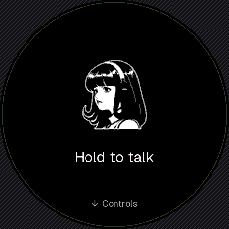
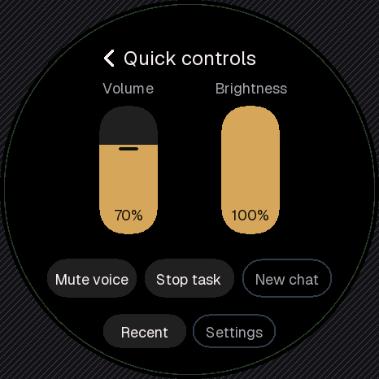
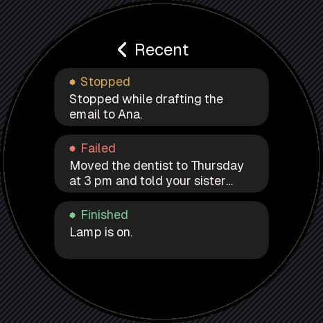

# Tiny

Tiny is a desk companion that talks to your own [Hermes Agent](https://github.com/NousResearch/hermes-agent). It runs on a Waveshare ESP32-S3 Touch AMOLED 1.75C: a 1.75-inch round 466×466 touchscreen with a microphone and speaker. Hold to talk, let go, and Hermes answers on the screen and out loud, using its own tools, memory and skills.

Tiny is a fork of [Hermes Gadget](https://github.com/Adolanium/hermes-gadget-sdk), taken at its 0.2.0 release (`323e330`). Gadget supplies the device protocol, the Hermes plugin, the simulator and support for many boards. Tiny builds a full round-screen companion on top of it: the face, the screens, the touch model, the work shelf, the display engine and the host changes behind them. [What Tiny adds](#what-tiny-adds) lists all of it; [What comes from Hermes Gadget](#what-comes-from-hermes-gadget) covers the rest.

<p align="center">
  
  
  
</p>
<p align="center"><sub>Home, quick controls and the Recent shelf, captured from the simulator, which runs the same device core as the firmware.</sub></p>

## What Tiny adds

### A face

- **An animated character instead of a static mascot.** The face plays a video pack converted offline: 14 clips (idle, listening, thinking, speaking, reply-ready, asking, alert, falling asleep, sleep, wake and their follow-on beats) of 96×96 four-level grey frames, drawn at 192×192 on true black. Nothing is decoded from MP4 on the device. Speaking is an authored animation, not lip-sync. See [the round companion face](docs/using-gadget.md#round-amoled-companion-face-466466).
- **Moods follow real state.** Reply-ready appears only for finished, unread text. Recording, speech, approvals and alerts cut in immediately instead of waiting for an animation to finish.
- **The clips' production pipeline** lives in [`animations/`](animations/README.md), and the converter is [`tools/build_expressions.py`](tools/build_expressions.py).

### Screens built for a round display

- **Face-first layout** set in [Geist](assets/fonts/README.md): smooth proportional text, a state word under the face, and status in Home's title slot.
- **Companion-style pairing, Settings, Wi-Fi setup and connection screens.** Offline, connecting and setup-needed screens say what's wrong, what it means and what to do next, instead of developer text in a pixel font.
- **Every target sits inside the circle.** Each one lights up while a finger rests on it and never acts from the highlight alone.

### Touch and navigation

- **Swipe between views:** Home, quick controls, the reader, Recent and its results, with a 220 ms eased slide. The destination takes input from the first frame, and recording, speech, approvals and errors never wait for motion. See [Touch navigation](docs/using-gadget.md#touch-navigation).
- **Navigating never acts.** You can move around while Hermes is thinking, streaming or speaking, and navigation never cancels, approves or records anything.
- **Each touch belongs to what it touched.** A Mute, Stop or Discard press can't land on a newer reply, turn or recording that appeared under your finger.
- **The reader holds your place.** It follows a streaming reply only while you're at the bottom; scroll up and it stays put.

### Quick controls

Swipe down from Home for volume and brightness sliders, **Mute voice**, **Stop task**, **New chat**, **Recent** and **Settings**. Buttons keep fixed positions and are outlined when unavailable, rather than moving or disappearing.

### Mute is not Stop

The SDK had a single Cancel. Tiny splits it into three separate actions. See [Mute voice, Stop task and Discard](docs/using-gadget.md#mute-voice-stop-task-and-discard).

- **Mute voice** quiets the speaker only.
- **Stop task** sends one stop request, shows **Stop requested**, then reports what Hermes says happened: **Stopped**, **Finished**, **Ended with an error**, or **Outcome unknown** if it never heard back. It never claims an undo.
- **Discard** drops a recording without making a request.

### Approvals you can read

When Hermes asks before doing something, the whole question scrolls, and equal **Yes** and **No** buttons stay locked until you've read to the end.

### Recent work

The last eight jobs (seven days at most) sit on a shelf as cards, each with a coloured outcome (Finished, Failed, Stopped, Working, Unknown) and an excerpt of the reply. Tap a card to read it. The shelf is kept on the host ([`plugin/work.py`](plugin/work.py)), so it survives restarts on both sides, and opening a job never reruns it. A job cut off by a disconnect shows as Unknown, not Finished. See [Recent results](docs/using-gadget.md#recent-results).

### Replies go to the right request

The host tags every message, edit and audio stream with the turn that produced it, and `turn.start` names the device request it serves. Late output from a stopped run can't land on a newer one, and a stop pressed before Hermes started can still be confirmed. See [the protocol](docs/protocol.md).

### Fresh conversations

- **Hold New chat** in quick controls for one second.
- **Or let it reset itself.** With `idle_reset_minutes` set, the host starts a new conversation when you speak after a quiet stretch.

Either way, memory, Recent results and settings stay. See [New chat](docs/using-gadget.md#new-chat) and [Conversations and idle reset](docs/hermes-integration.md#conversations-and-idle-reset).

### Knows the time

Hermes sends its wall clock and timezone when Tiny connects and on every heartbeat, so Tiny needs no NTP. It keeps counting through Wi-Fi drops and stops claiming a time 12 hours after its last sync. Older devices ignore the field, and older hosts just leave it out. See [the protocol](docs/protocol.md).

### A faster display

On the 1.75C:

- **Flushes go by DMA through internal RAM**, so the SPI transfer never reads from slow PSRAM.
- **Updates send only the columns that changed:** the face, the mic meter, a pressed button.
- **Slides are composed from one cached render** of the destination.
- **The app loop has its own CPU core**, away from Wi-Fi.

A full-screen flush went from 180 ms to about 40 ms. Tiny reports display timing as `perf_*` sensors and has a `display.bench` action that measures slides and redraws on the device itself. See [Development](docs/development.md).

### Flash sized for the board

The 1.75C has 32 MB of flash, so Tiny uses two 8 MB app slots ([`partitions-32mb.csv`](firmware/esp32/partitions-32mb.csv)) instead of the SDK's two 1.94 MB slots. The current build is about 1.8 MB, leaving the slot about 78% free. Moving an existing board to the new slots takes one USB flash, and its settings, Wi-Fi and pairing key survive it. See [Hardware](docs/hardware.md).

Each board also carries only the art it draws:

| Flag | On for | What it holds |
|---|---|---|
| `CONFIG_HG_EXPRESSION_PACK` | Round AMOLED boards | The face video, about 443 KB |
| `CONFIG_HG_LEGACY_MASCOT` | Every other board | The SDK's 1-bit mascot, about 27 KB |

### Tested end to end

- **Workflow tests** drive the real device core and the production device hub over loopback with disposable stores, plus a lane against a real Hermes gateway. They cover navigation, touch ownership, stop outcomes, the shelf, approvals, New chat, idle reset, time and the display path.
- **Screenshot checks.** [`tools/design_capture.py`](tools/design_capture.py) walks the core through every screen, confirms each one reached its intended state, and produces byte-identical captures from run to run, so before/after comparisons show only real changes.

## In progress

These are being built on the `tiny/improve` branch and are not on `main` yet:

- An idle face with the time (Portrait, Portrait + time or Clock). Until it lands, Tiny receives the time but doesn't draw it.
- Larger Home text, and a small mark when something needs you.
- Visible **Retry now** and **Settings** on the offline screens, and **Done** in Settings.
- Quick controls in four bands, with taller targets and sliders you can drag from anywhere.
- How long ago each Recent job ran, and a tappable **Last task**.
- A countdown timer Hermes can set, with a local alarm that works without Wi-Fi.

## What comes from Hermes Gadget

Tiny keeps these from the SDK, largely as they were:

- **The core loop:** the WebSocket device protocol, push-to-talk audio streaming, streamed text and speech replies, and pairing with a code.
- **The Hermes platform plugin** and its agent tools, so Hermes can call device actions and read sensors.
- **Over-the-air updates** with automatic rollback, phone-based Wi-Fi setup, and the on-device settings and hardware checks.
- **The desktop simulator**, which runs the same C++ core as the firmware.
- **Every other target:** ESP32-S3 boards from Waveshare, Espressif, M5Stack and LilyGO, the [Raspberry Pi 4/5 Linux client](docs/linux.md), and the [Home Assistant and MQTT examples](docs/home-automation.md). These keep the SDK's original interface; everything in [What Tiny adds](#what-tiny-adds) applies to 466×466 round boards. See [Supported hardware](docs/supported-hardware.md).

## Try it without hardware

With Python 3.10+, CMake 3.16+ and a C++17 compiler:

```bash
python -m pip install -e ".[dev]"
hermes-gadget build-sim --test
hermes-gadget devserver --pairing
```

In a second terminal:

```bash
hermes-gadget sim --url ws://127.0.0.1:8765/gadget --board sim-466x466-round
```

Type `approve <CODE>` in the first terminal using the code on the simulated screen, then type a message to get a streamed echo. Real conversations need Hermes with the Gadget plugin; see [Connect Hermes](docs/connect-hermes.md). The [desktop guide](docs/desktop.md) covers platform setup and live audio.

## Build and flash Tiny

```bash
python -m platformio run --project-dir firmware/esp32 -e esp32s3-touch-amoled-175c
```

The first install, or the move to 8 MB slots, is over USB: see [Set up a board](docs/setup-board.md). After that, use `hermes gadget update`. The build checks its own size against the slot it's going into.

Run the tests with `pytest`. Simulator results and successful builds are not hardware verification; a port counts as verified only with a complete physical report. See [Hardware verification](docs/hardware-validation.md).

## Guides

| Using Tiny | Building on it |
|---|---|
| [Talk, type and interrupt](docs/using-gadget.md) | [Development and tests](docs/development.md) |
| [Set up a board](docs/setup-board.md) | [Architecture](docs/architecture.md) |
| [Connect Hermes](docs/connect-hermes.md) | [Protocol](docs/protocol.md) |
| [Hermes integration reference](docs/hermes-integration.md) | [Add a board, actions or sensors](docs/porting.md) |
| [Try the simulator](docs/simulator.md) | [Customize the face](docs/faces.md) |
| [Troubleshooting](docs/troubleshooting.md) | [Hardware and wiring](docs/hardware.md) |
| [Remote access with Tailscale Funnel](docs/tailscale-funnel.md) | [Workspace history and recovery](docs/tiny-workspace.md) |

The original idea is in [`IDEA.md`](IDEA.md).

## Credits

Tiny is built on [Hermes Gadget](https://github.com/Adolanium/hermes-gadget-sdk) by Adolanium and its contributors; the [changelog](CHANGELOG.md) has SDK release notes and contributor credits. Text is set in [Geist](assets/fonts/README.md) under the SIL Open Font License.

Contributions follow [CONTRIBUTING.md](CONTRIBUTING.md). Report security problems privately through [SECURITY.md](SECURITY.md).

## Affiliation and trademarks

Tiny and Hermes Gadget are **independent, community-made projects**. They are not affiliated with, endorsed by, sponsored by or supported by Nous Research.

"Hermes", "Hermes Agent", "Nous Research" and the Hermes Agent mascot (the girl with the headphones, sometimes called "Nous Girl") are trademarks or brand assets of Nous Research. They appear here only to describe compatibility with Hermes Agent.

## License

Project code and documentation are licensed under the [MIT license](LICENSE).

Third-party dependencies, adapted drivers and artwork keep their own licenses. See [Third-party licenses and attribution](THIRD_PARTY_NOTICES.md) and [NOTICE](NOTICE).

The MIT license grants no rights to Nous Research's names or marks.
